<div align="center">

<!-- 1. HERO: THE CHAOTIC WORKSTATION (FLAT 2D VECTOR) -->
<picture>
  <source media="(prefers-color-scheme: dark)" srcset="./assets/header-dark.svg" />
  <source media="(prefers-color-scheme: light)" srcset="./assets/header-light.svg" />
  
</picture>

# Sohil

**Full-Stack Builder & Autonomous Systems Explorer**

*IDEAS → CODE → IMPACT*

📍 **Base**: Tamil Nadu, India &nbsp;•&nbsp; 🎓 **Academic**: Undergraduate, Artificial Intelligence & Data Science &nbsp;•&nbsp; ⚡ **Status**: Open to internships, research collabs & open-source builds

</div>

---

### 🕹️ Developer Overview // Recruiter Brief

Undergraduate software developer focused on architecting deterministic full-stack web platforms, static code security tools, and multimodal AI pipelines. I enjoy designing clean, transparent systems from scratch and building tools that make developers faster.

- **Primary Focus**: Full-stack web engineering, static code security analyzers & multimodal AI pipelines.
- **Production Core**: Python, TypeScript, React 19, FastAPI, PostgreSQL, Linux & Docker.
- **Flagship Project**: [`DERMA-VORTEX-AI`](https://github.com/sohilmohith122-bitqq/DERMA-VORTEX-AI) — Multimodal dermatological clinical screening platform.

---

### 👾 Selected Work // Collectible Project Arcade

<div align="center">
  <a href="https://github.com/sohilmohith122-bitqq/DERMA-VORTEX-AI"><picture><source media="(prefers-color-scheme: dark)" srcset="./assets/projects/card-lvl-01-derma-vortex-ai-dark.svg" /><source media="(prefers-color-scheme: light)" srcset="./assets/projects/card-lvl-01-derma-vortex-ai-light.svg" /></picture></a>&nbsp;&nbsp;<a href="https://github.com/sohilmohith122-bitqq/Network-Anomaly-Detection"><picture><source media="(prefers-color-scheme: dark)" srcset="./assets/projects/card-lvl-02-network-anomaly-detection-dark.svg" /><source media="(prefers-color-scheme: light)" srcset="./assets/projects/card-lvl-02-network-anomaly-detection-light.svg" /></picture></a>
  <br/><br/>
  <a href="https://github.com/sohilmohith122-bitqq/MEDSCOPE-AI"><picture><source media="(prefers-color-scheme: dark)" srcset="./assets/projects/card-lvl-03-medscope-ai-dark.svg" /><source media="(prefers-color-scheme: light)" srcset="./assets/projects/card-lvl-03-medscope-ai-light.svg" /></picture></a>&nbsp;&nbsp;<a href="https://github.com/sohilmohith122-bitqq/NEMESIS"><picture><source media="(prefers-color-scheme: dark)" srcset="./assets/projects/card-lvl-04-nemesis-dark.svg" /><source media="(prefers-color-scheme: light)" srcset="./assets/projects/card-lvl-04-nemesis-light.svg" /></picture></a>
</div>

<br/>

#### ❯ Verified Public Repository Registry

| Level | Project | Description | Stack | Link |
| :---: | :--- | :--- | :--- | :---: |
| `LVL 01` | **[DERMA-VORTEX-AI](https://github.com/sohilmohith122-bitqq/DERMA-VORTEX-AI)** | Multimodal dermatological AI screening and clinical assessment platform | `TypeScript` `React 19` `Vite` | [`launch →`](https://github.com/sohilmohith122-bitqq/DERMA-VORTEX-AI) |
| `LVL 02` | **[Network-Anomaly-Detection](https://github.com/sohilmohith122-bitqq/Network-Anomaly-Detection)** | Real-time telemetry analysis and network anomaly detection pipeline | `Python` `FastAPI` `Telemetry` | [`launch →`](https://github.com/sohilmohith122-bitqq/Network-Anomaly-Detection) |
| `LVL 03` | **[MEDSCOPE-AI](https://github.com/sohilmohith122-bitqq/MEDSCOPE-AI)** | Evidence-first clinical event timeline and health records engine | `Next.js` `TypeScript` `Prisma` | [`launch →`](https://github.com/sohilmohith122-bitqq/MEDSCOPE-AI) |
| `LVL 04` | **[NEMESIS](https://github.com/sohilmohith122-bitqq/NEMESIS)** | Autonomous dual-loop voice assistant and security testing environment | `Python` `Faster-Whisper` `CUDA` | [`launch →`](https://github.com/sohilmohith122-bitqq/NEMESIS) |

---

### 🧰 Skills & Tools // Flat 2D Artifacts

<div align="center">
  <picture><source media="(prefers-color-scheme: dark)" srcset="./assets/skills/lang-python-dark.svg" /><source media="(prefers-color-scheme: light)" srcset="./assets/skills/lang-python-light.svg" /></picture>
  <picture><source media="(prefers-color-scheme: dark)" srcset="./assets/skills/lang-ts-dark.svg" /><source media="(prefers-color-scheme: light)" srcset="./assets/skills/lang-ts-light.svg" /></picture>
  <picture><source media="(prefers-color-scheme: dark)" srcset="./assets/skills/lang-js-dark.svg" /><source media="(prefers-color-scheme: light)" srcset="./assets/skills/lang-js-light.svg" /></picture>
  <picture><source media="(prefers-color-scheme: dark)" srcset="./assets/skills/tool-react-dark.svg" /><source media="(prefers-color-scheme: light)" srcset="./assets/skills/tool-react-light.svg" /></picture>
  <br/><br/>
  <picture><source media="(prefers-color-scheme: dark)" srcset="./assets/skills/tool-node-dark.svg" /><source media="(prefers-color-scheme: light)" srcset="./assets/skills/tool-node-light.svg" /></picture>
  <picture><source media="(prefers-color-scheme: dark)" srcset="./assets/skills/tool-fastapi-dark.svg" /><source media="(prefers-color-scheme: light)" srcset="./assets/skills/tool-fastapi-light.svg" /></picture>
  <picture><source media="(prefers-color-scheme: dark)" srcset="./assets/skills/tool-git-dark.svg" /><source media="(prefers-color-scheme: light)" srcset="./assets/skills/tool-git-light.svg" /></picture>
  <picture><source media="(prefers-color-scheme: dark)" srcset="./assets/skills/tool-linux-dark.svg" /><source media="(prefers-color-scheme: light)" srcset="./assets/skills/tool-linux-light.svg" /></picture>
</div>

<br/>

**⚡ Actively Leveling Up In**:
`[ ⯌ ]` Distributed Systems &nbsp;•&nbsp; `[ ⯌ ]` System Design &nbsp;•&nbsp; `[ ⯌ ]` Cybersecurity Heuristics &nbsp;•&nbsp; `[ ⯌ ]` Rust

---

### 📐 Engineering Principles // SOHIL.exe

| Principle | Core Directive | Practice |
| :---: | :--- | :--- |
| **01** | **IDEAS** | First-principles systems architecture & deterministic domain modeling. |
| **02** | **CODE** | Clean, zero-bloat vector & runtime implementations with strict type safety. |
| **03** | **IMPACT** | Autonomous tooling engineered to eliminate friction for developers. |

---

### 📊 Real Telemetry // Verified GitHub Data Art

<div align="center">
  <!-- Core Public Metrics -->
  <picture>
    <source media="(prefers-color-scheme: dark)" srcset="./assets/stats-dark.svg" />
    <source media="(prefers-color-scheme: light)" srcset="./assets/stats-light.svg" />
    
  </picture>

  <br/><br/>

  <!-- 12-Week Commit Velocity Matrix -->
  <picture>
    <source media="(prefers-color-scheme: dark)" srcset="./assets/activity-dark.svg" />
    <source media="(prefers-color-scheme: light)" srcset="./assets/activity-light.svg" />
    
  </picture>
</div>

---

### 📡 Ping Me // Direct Telemetry

<div align="center">

| Channel | Endpoint | Status |
| :--- | :--- | :---: |
| **Professional Network** | `[EDIT: Add LinkedIn in profile.config.json]` | `CONNECTED` |
| **Direct Inbox** | `[EDIT: Add Email in profile.config.json]` | `MONITORED` |
| **Source Repositories** | [github.com/sohilmohith122-bitqq](https://github.com/sohilmohith122-bitqq) | `PUBLIC` |

<br/>

<picture>
  <source media="(prefers-color-scheme: dark)" srcset="./assets/signature-dark.svg" />
  <source media="(prefers-color-scheme: light)" srcset="./assets/signature-light.svg" />
  
</picture>

```bash
# SOHIL.exe // [ ⯌ ] IDEAS → CODE → IMPACT
exit 0
```

</div>
