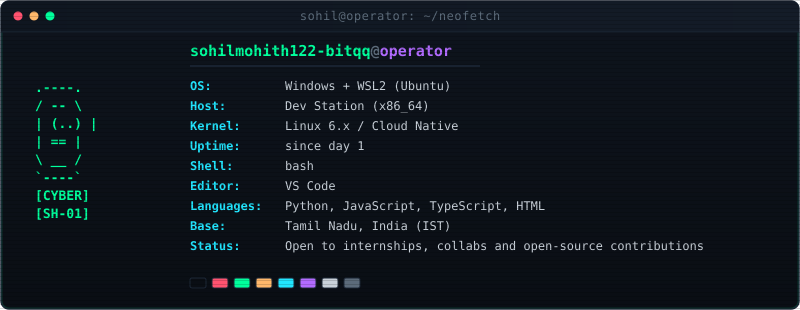
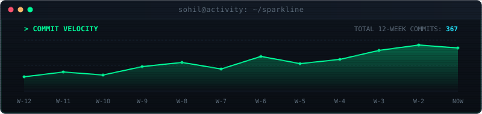

<div align="center">

<!-- 1. HERO BOOT SEQUENCE -->


<br/>


</div>

## ❯ $ neofetch

<div align="center">
  
</div>

<div align="center">
  
</div>

## ❯ $ cat skills.json

```json
{
  "languages": [
    "Python",
    "JavaScript",
    "TypeScript",
    "HTML",
    "CSS"
  ],
  "frameworks_tools": [
    "React",
    "Node.js",
    "FastAPI",
    "Git",
    "GitHub Actions",
    "Linux",
    "Antigravity"
  ],
  "learning": [
    "Data Structures & Algorithms",
    "System Design",
    "Cybersecurity basics",
    "TypeScript"
  ]
}
```

<div align="center">
  
</div>

## ❯ $ ls -la ~/projects

| Perms | Repository | Description | Stack | Link |
| :--- | :--- | :--- | :---: | :---: |
| `drwxr-xr-x` | **[DERMA-VORTEX-AI](https://github.com/sohilmohith122-bitqq/DERMA-VORTEX-AI)** | Multimodal dermatological AI screening and clinical assessment platform | `TypeScript` | [`launch →`](https://github.com/sohilmohith122-bitqq/DERMA-VORTEX-AI) |
| `drwxr-xr-x` | **[Network-Anomaly-Detection](https://github.com/sohilmohith122-bitqq/Network-Anomaly-Detection)** | Real-time telemetry analysis and anomaly detection pipeline | `Python` | [`launch →`](https://github.com/sohilmohith122-bitqq/Network-Anomaly-Detection) |
| `drwxr-xr-x` | **[MEDSCOPE-AI](https://github.com/sohilmohith122-bitqq/MEDSCOPE-AI)** | Evidence-first clinical event timeline and health records engine | `TypeScript` | [`launch →`](https://github.com/sohilmohith122-bitqq/MEDSCOPE-AI) |
| `drwxr-xr-x` | **[NEMESIS](https://github.com/sohilmohith122-bitqq/NEMESIS)** | Autonomous dual-loop voice assistant and security testing environment | `Python` | [`launch →`](https://github.com/sohilmohith122-bitqq/NEMESIS) |

<div align="center">
  
</div>

## ❯ $ git stats

<div align="center">
  <!-- Stats & Code Distribution Card -->
  <picture>
    <source media="(prefers-color-scheme: dark)" srcset="./assets/stats.svg" />
    <source media="(prefers-color-scheme: light)" srcset="./assets/stats.svg" />
    
  </picture>

  <br/>

  <!-- Commit Velocity Sparkline Card -->
  <picture>
    <source media="(prefers-color-scheme: dark)" srcset="./assets/activity.svg" />
    <source media="(prefers-color-scheme: light)" srcset="./assets/activity.svg" />
    
  </picture>
</div>

<div align="center">
  
</div>

## ❯ $ ./snake

<div align="center">
  <picture>
    <source media="(prefers-color-scheme: dark)" srcset="./assets/snake-dark.svg" />
    <source media="(prefers-color-scheme: light)" srcset="./assets/snake.svg" />
    
  </picture>
</div>

<div align="center">
  
</div>

## ❯ $ ping me

```bash
# DIRECT TELEMETRY & COMMS LINK
- **LinkedIn**: `[EDIT: Add LinkedIn URL in profile.config.json]`
- **Email**: `[EDIT: Add contact email in profile.config.json]`

# STATUS: DISCONNECTED
exit 0
```
