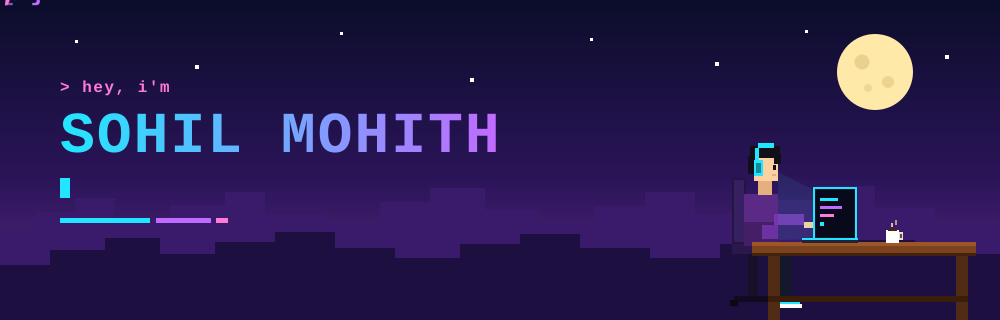

 

---

## 🎮 Player Card

| Attribute | Stats & Details |
| :--- | :--- |
| **👤 Name** | Sohil Mohith |
| **⚔️ Class** | `[EDIT: CS Student & Aspiring Full-Stack Developer]` |
| **📍 Base** | Chennai, India 🇮🇳 |
| **🎯 Current Quest** | `[EDIT: Building AI-powered developer utilities & web platforms]` |
| **⚡ Leveling Up In** | `[EDIT: Distributed systems, Next.js, Cloud Architectures]` |
| **☕ Fuel** | `[EDIT: Chai, lo-fi beats, late-night gaming]` |

---

## 🧰 Skill Tree

### ⚔️ Main weapons

  
  
  
  
  
  

### 🏹 Side quests

  
  
  
  
  

### 🎒 Inventory

  
  
  
  
  
  

<!-- [EDIT: Adjust badges above to reflect your customized weapons & inventory] -->

---

## 🗺️ Featured Quests

| Quest | What it does | Tech | Link |
| :--- | :--- | :--- | :---: |
| **[EDIT: Arctic Code Sens]** | [EDIT: AI-assisted multi-language static code analyzer & vulnerability detector] | `React` `TypeScript` `FastAPI` | [▶ play](https://github.com/sohilmohith122-bitqq/[EDIT: ARCTIC-CODE-SENS]) |
| **[EDIT: LandVault-AI]** | [EDIT: Intelligent multilingual land deed digitization & GIS parcel verification] | `React` `Python` `PostgreSQL` | [▶ play](https://github.com/sohilmohith122-bitqq/[EDIT: LANDVAULT-AI]) |
| **[EDIT: MedScope-AI]** | [EDIT: Evidence-first clinical event timeline & patient health records engine] | `Next.js` `TypeScript` `Prisma` | [▶ play](https://github.com/sohilmohith122-bitqq/[EDIT: MEDSCOPE-AI]) |

---

## 📊 Stats

 

---

## 🐍 Contribution Snake

  <picture>
    <source media="(prefers-color-scheme: dark)" srcset="https://raw.githubusercontent.com/sohilmohith122-bitqq/sohilmohith122-bitqq/output/snake-dark.svg" />
    <source media="(prefers-color-scheme: light)" srcset="https://raw.githubusercontent.com/sohilmohith122-bitqq/sohilmohith122-bitqq/output/snake.svg" />
    
  </picture>

---

## 📡 Ping Me

&nbsp;&nbsp;

  

*Open to collabs, internships & good chai. Let's build something cool. ✨*

