<div align="center">

<!-- 1. HERO: THE CHAOTIC WORKSTATION (FLAT 2D VECTOR) -->
<picture>
  <source media="(prefers-color-scheme: dark)" srcset="./assets/header-dark.svg" />
  <source media="(prefers-color-scheme: light)" srcset="./assets/header-light.svg" />
  
</picture>

# Sohil

**{{HEADLINE}}**

*{{TAGLINE}}*

📍 **Base**: {{LOCATION}} &nbsp;•&nbsp; 🎓 **Academic**: {{EDUCATION}} &nbsp;•&nbsp; ⚡ **Status**: {{AVAILABILITY}}

</div>

---

### 🕹️ Developer Overview // Recruiter Brief

{{ABOUT}}

- **Primary Focus**: Full-stack web engineering, static code security analyzers & multimodal AI pipelines.
- **Production Core**: Python, TypeScript, React 19, FastAPI, PostgreSQL, Linux & Docker.
- **Flagship Project**: [`DERMA-VORTEX-AI`](https://github.com/sohilmohith122-bitqq/DERMA-VORTEX-AI) — Multimodal dermatological clinical screening platform.

---

### 👾 Selected Work // Collectible Project Arcade

{{PROJECT_CARDS_GALLERY}}

<br/>

#### ❯ Verified Public Repository Registry

{{PROJECTS_TABLE}}

---

### 🧰 Skills & Tools // Flat 2D Artifacts

{{SKILLS_TILES_GALLERY}}

<br/>

**⚡ Actively Leveling Up In**:
{{LEARNING_LIST}}

---

### 📐 Engineering Principles // SOHIL.exe

| Principle | Core Directive | Practice |
| :---: | :--- | :--- |
| **01** | **IDEAS** | First-principles systems architecture & deterministic domain modeling. |
| **02** | **CODE** | Clean, zero-bloat vector & runtime implementations with strict type safety. |
| **03** | **IMPACT** | Autonomous tooling engineered to eliminate friction for developers. |

---

### 📊 Real Telemetry // Verified GitHub Data Art

<div align="center">
  <!-- Core Public Metrics -->
  <picture>
    <source media="(prefers-color-scheme: dark)" srcset="./assets/stats-dark.svg" />
    <source media="(prefers-color-scheme: light)" srcset="./assets/stats-light.svg" />
    
  </picture>

  <br/><br/>

  <!-- 12-Week Commit Velocity Matrix -->
  <picture>
    <source media="(prefers-color-scheme: dark)" srcset="./assets/activity-dark.svg" />
    <source media="(prefers-color-scheme: light)" srcset="./assets/activity-light.svg" />
    
  </picture>
</div>

---

### 📡 Ping Me // Direct Telemetry

<div align="center">

| Channel | Endpoint | Status |
| :--- | :--- | :---: |
| **Professional Network** | {{LINKEDIN_LINK}} | `CONNECTED` |
| **Direct Inbox** | {{EMAIL_LINK}} | `MONITORED` |
| **Source Repositories** | [github.com/sohilmohith122-bitqq](https://github.com/sohilmohith122-bitqq) | `PUBLIC` |

<br/>

<picture>
  <source media="(prefers-color-scheme: dark)" srcset="./assets/signature-dark.svg" />
  <source media="(prefers-color-scheme: light)" srcset="./assets/signature-light.svg" />
  
</picture>

```bash
# SOHIL.exe // [ ⯌ ] IDEAS → CODE → IMPACT
exit 0
```

</div>
